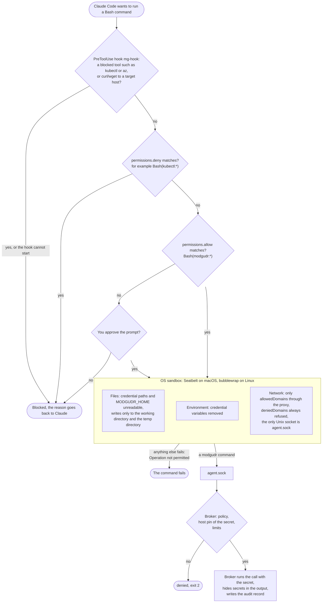

# modgudr

modgudr is a local secret broker for coding agents and scripts. It holds the credentials for your
databases and Kubernetes clusters, so that the agent, the script or the Python process that needs
data never sees a password or a token. It asks the broker; the broker decides, runs the call,
hides secrets in the output and writes an audit record.

Why:

- A coding agent that can read `~/.kube`, a `.env` file or a pasted connection string can leak or
  misuse what it finds. With modgudr the credential is in the broker's memory only.
- A policy of two layers decides what each environment allows (read in prod, more in test), with
  a company file that nothing running as you can change, and a targets file you own.
- Every call is classified (`select`, `delete`, `get/pods`, …), checked against that policy, limited
  in rows, bytes and time, and audited.

The MVP has:

- a stdlib-only client (the `modgudr` command and `import modgudr`);
- a broker daemon with two sockets (`agent.sock` for target operations, `human.sock` for `unlock`,
  `lock` and `audit tail`);
- connectors for SQL (Snowflake and Oracle) and `kubectl` (on AKS, through the Azure CLI);
- stores: `bws` (Bitwarden Secrets Manager, attended) and `file` (development and tests);
- tooling to confine Claude Code: `modgudr agent-setup claude`, `modgudr agent run claude`,
  `modgudr doctor` and a Claude Code skill.

## Warning: L0 protects against accidents only

```
WARNING: modgudr runs as your own user and no agent isolation is configured.
         Both sockets, the policy and the unlock are reachable by anything you run,
         including coding agents. This set-up protects against accidents only.
         Run `modgudr agent-setup claude` and install the managed settings, or install at L1.
```

At L0 the broker is a process of your own user. Anything else that runs as you can reach both
sockets. The boundary comes from the agent's isolation: the managed settings that
`modgudr agent-setup claude` generates keep the agent out of `human.sock`, the policy and
`MODGUDR_HOME`. Until you have installed them (and `modgudr doctor` agrees), treat modgudr as a
guard against mistakes, not against a hostile process. `modgudr status` and `modgudr doctor` print
this warning for as long as it is true.

## Quick start

You need [uv](https://docs.astral.sh/uv/), and for the `bws` store the Bitwarden Secrets Manager
command line (see [Bitwarden licence](#bitwarden-licence)).

1. **Install** from a checkout. This puts `modgudr` and `modgudr-broker` in `~/.local/bin`:

       sh dist/install-l0.sh --dry-run     # print what it would do
       sh dist/install-l0.sh

2. **Write the policy.** Copy the examples from `dist/policy.d/`, edit hosts, users and the
   Bitwarden project (`store.bws.project`, and `store.bws.serverUrl` when your vault is not the
   US cloud, for example `https://vault.bitwarden.eu`), and install the company file as root, so
   that nothing running as you can widen it:

       mkdir -p -m 0700 ~/.modgudr ~/.modgudr/policy.d
       sudo install -o root -m 0644 dist/policy.d/00-company.example.yaml ~/.modgudr/policy.d/00-company.yaml
       install -m 0644 dist/policy.d/50-targets.example.yaml ~/.modgudr/policy.d/50-targets.yaml
       modgudr-broker lint

   Each secret is a Bitwarden item whose note pins where it may be sent:

       modgudr-hosts: db-test.example.net:1521
       modgudr-env: test

   A secret without a host pin is refused. The policy is read at start-up; after an edit,
   restart the broker.

3. **Start the broker** in a terminal and leave it running:

       modgudr-broker

4. **Unlock** in another terminal. Unlock works from your own terminal only, never over `agent.sock`:

       modgudr unlock
       modgudr status

5. **Run a first query:**

       modgudr targets
       modgudr ora-test tables
       modgudr ora-test query "select id, status from orders where id = :id" -p id:int=42

6. **Confine the agent.** Generate the Claude Code managed settings and the hook, install the
   output as `modgudr agent-setup claude` tells you, and check:

       modgudr agent-setup claude
       modgudr doctor

For development without a vault, `modgudr-broker --dev --secrets-file FILE` serves secrets from a
local file. Dev mode is for tests: it marks every audit line `dev: true` and is refused when the
`bws` store is configured.

## Commands

| Command | What it does |
| --- | --- |
| `modgudr targets [--json] [--system S]` | list the targets |
| `modgudr describe <target>` | a target's operations, limits and facts |
| `modgudr <target> <op> …` | run an operation; `system@env` addresses an environment |
| `modgudr explain <target> <op> …` | what the policy would decide, without running anything |
| `modgudr actions <type>` | a connector's action catalogue |
| `modgudr policy show <target>`, `modgudr policy lint` | the effective rules; check the policy |
| `modgudr status [--quiet\|--json]` | broker state; `--quiet` exits 0 unlocked, 3 locked, 6 down |
| `modgudr unlock`, `modgudr lock` | the store session (your own terminal only) |
| `modgudr audit tail [options]` | recent audit records as ndjson (your own terminal only) |
| `modgudr login azure <target> [--device-code]` | the Azure CLI login of a custody target |
| `modgudr agent-setup claude [--out DIR] [--allow-domain D]… [--remove-domain D]…` | generate the Claude Code managed settings and hook |
| `modgudr agent run claude [--env E] [--pass-env NAME]… [-- ARGS]` | start Claude Code with a clean environment |
| `modgudr doctor [--agent claude]` | check the set-up; `--agent` also probes the sandbox (spends API tokens) |
| `modgudr agent-docs claude` | print the Claude Code skill |
| `modgudr-broker [--dev] [lint]` | the broker; `lint` checks the policy offline |

SQL operations: `query`, `write` (`--dry-run` rolls back after reporting `affectedRows`), `tables`,
`describe`, `count`, `sample`, and on Oracle `plan`. Bind values with `-p name=value` or
`-p name:int=42`, and refer to them as `:name`; never paste values into the statement. Kubernetes:
`modgudr aks-test kubectl get pods -n app-test`.

The environment of a call is `system@env`, else `$MODGUDR_ENV`, else the policy's default.

From Python:

```python
import modgudr

rows = (
    modgudr.connect()
    .sql("ora-test")
    .query("select id from orders where status = :s", params={"s": "new"})
)
```

The wire protocol is in [docs/protocol.md](docs/protocol.md).

## Exit codes

| Code / outcome | Exit | Python | Notes |
| --- | --- | --- | --- |
| ok | 0 | — | |
| `denied` | 2 | `Denied` | policy, pinning, ceiling, constraints; also a write rolled back for `maxAffectedRows` and `--max-rows` above `maxRowsHard` |
| `locked` | 3 | `Locked` | |
| `limit` (truncated by `maxRows`/`maxBytes`) and `timeout` | 4 | `LimitExceeded` (`.partial`) | `--allow-truncated` makes 4 into 0 for read operations only; writes that time out are rolled back and stay 4 |
| `upstream` | 5 | `UpstreamError` | database, `az` or `kubectl` exit ≠ 0 (raw code in the trailer), store item missing, authentication failure after retry |
| `unavailable` | 6 | `BrokerUnavailable` | broker down, socket refused, admin operation from an agent session, connection lost without a trailer |
| `throttled` | 7 | `Throttled` (`.retry_after`) | `maxConcurrent` or failed-unlock limit; calls are never queued |
| `bad_request`, `not_found`, usage errors | 64 | `UsageError` (subclass of `modgudr.Error`) | the message lists valid values |
| `internal` | 70 | `Error` | including an audit log that cannot be written |
| `doctor` found a deviation | 1 | — | |
| `agent run` / `doctor --agent` cannot run | 69 | — | `claude` missing, not logged in, or the probe was inconclusive |
| broker start-up refused | 78 | — | policy, owner or audit directory |
| Ctrl-C / reader closed the pipe | 130 / 141 | — | silent |
| `status --quiet` | 0 unlocked, 3 locked, 6 down | — | a gate for scripts |

## Claude Code sessions and Bash prompts

`modgudr agent run claude` starts Claude Code with a clean environment (a short allowlist plus
whatever you add with `--pass-env`) and sets `CLAUDE_CODE_SUBPROCESS_ENV_SCRUB=1`. That variable
**turns the sandbox's automatic approval of Bash commands off**: a Bash command that is not in the
allow list prompts you for approval. The `modgudr` command itself is allowed. Expect a prompt for
anything else the agent runs.

## How a Bash command from Claude Code is checked

With the managed settings installed, every Bash command the agent runs passes the checks below.
Any one of them can stop it. The hook only steers (it misses `bash -c "kubectl …"`); the sandbox
and the deny rules are the boundary.



Where each piece is configured:

| What | Where | Owner |
| --- | --- | --- |
| Managed settings: sandbox, deny and allow rules, the hook entry | macOS `/Library/Application Support/ClaudeCode/managed-settings.d/50-modgudr.json`, Linux `/etc/claude-code/managed-settings.d/50-modgudr.json` | root |
| The hook | `/opt/modgudr/bin/mg-hook`, run as `/usr/bin/python3 -I` | root |
| Your own Claude Code settings | `~/.claude/settings.json`, `.claude/settings.json`, `.claude/settings.local.json`; they cannot override keys the managed file sets | you |
| Policy | `$MODGUDR_HOME/policy.d/` (default `~/.modgudr/policy.d/`): `00-company.yaml`, `50-targets.yaml` | root, you |
| `agent.sock` | macOS `~/Library/Caches/modgudr/run/agent.sock`, Linux `$XDG_RUNTIME_DIR/modgudr/agent.sock` | you |
| `human.sock` | `$MODGUDR_HOME/run/human.sock`, out of the sandbox's reach | you |
| Audit | `$MODGUDR_HOME/audit/audit-YYYY-MM-DD.jsonl` | you |

`modgudr agent-setup claude` generates the managed settings and the hook. `modgudr doctor` checks
that they are installed and complete.

`agent-setup` and `doctor` use the code of the checkout they are installed from, and the broker uses the
code it started with. After a change to the required settings, generate and install the drop-in, then
restart the broker.

### Writing to another folder

The agent can write only to its working directory and the temp directory. To let it write to
another folder for the current session, type this in Claude Code:

    /add-dir ~/projects/other-repo

The folder opens to both Claude's file tools and the Bash sandbox, for this session only;
`/permissions` lists it. The managed deny rules still apply inside it. Project settings
(`.claude/settings.json`, `.claude/settings.local.json`) cannot do this: while the managed settings
are installed, Claude Code ignores `sandbox.filesystem.allowWrite` from them.

The managed settings also set `permissions.blockWritesOutsideWorkingDirectories` (Claude Code
2.1.314 or later). It makes the file tools refuse paths outside the working directories in every
permission mode, and `/add-dir` adds a working directory. The key also refuses Claude Code's
settings files inside the working directories, and it removes `EnterWorktree` and `ExitWorktree`.

### Reaching the internet: WebFetch and curl

Claude Code reaches the web in two ways, and the managed settings treat them differently:

| | WebFetch tool | `curl`, `wget`, `pip`, … in Bash |
| --- | --- | --- |
| Runs in | Claude Code itself | the OS sandbox |
| Allowed hosts | any public page, except the `WebFetch(domain:…)` deny rules for target hosts | only `sandbox.network.allowedDomains` in the managed file |
| What the agent gets | the page as markdown, summarised by a small model | the raw response, which a script can save or process |

So the agent can read `https://www.vg.no` with WebFetch, but `curl https://www.vg.no` fails:

    curl: (56) CONNECT tunnel failed, response 403

The managed file sets `allowManagedDomainsOnly` and `strictAllowlist`, so its `allowedDomains` is
the whole list. Domains in your own settings are ignored, and the agent cannot ask for one more
host for a single command. To let Bash reach a host, generate the managed settings again with the
domain added and install the file again:

    modgudr agent-setup claude --force --allow-domain www.vg.no

`--allow-domain` adds to the list in the installed drop-in, and `--remove-domain` takes one away.
With no drop-in installed, the list starts from the defaults. For a single download, type
`! curl …` in Claude Code instead: a command that starts with `!` runs outside the sandbox.

`~/.git-credentials` and `~/.ssh` are denied, so git to a private repository fails in the sandbox.
Run it with `!`.

## Bitwarden licence

The `bws` store runs the Bitwarden Secrets Manager command line, `bws`, as a subprocess. modgudr
contains no Bitwarden code: it does not import, vendor, lock, download or ship `bws` or the
Bitwarden SDK, and `dist/install-l0.sh` and CI never fetch them. You install `bws` yourself, from
the release page at <https://github.com/bitwarden/sdk-sm/releases> (check the release zip against
the checksum file published with it), and it is licensed to you by Bitwarden under Bitwarden's own
agreement, not under modgudr's.

Read that agreement. At the time of writing it permits, among other uses:

- developing, testing and demonstrating a compatible application;
- personal or family use;
- internal business use with a paid Bitwarden server licence.

Whether your use falls under one of them is for you to decide. The tests use a fake `bws`
(`tests/fixtures/bin/bws`), so a checkout never needs the real one.

## Development

    uv sync --locked
    sh scripts/check.sh tests -m "not oracle"     # ruff, pyright, pytest
    bats bats/

`scripts/check.sh` is the single test entry point. The Oracle tests need Docker and the
`gvenzl/oracle-free:23-slim-faststart` image (`sh scripts/check.sh tests/integration/oracle`). The
kind tests run in CI only. The workspace members are under `packages/`; the CI workflow is in
`.github/workflows/ci.yml`.

## Licence

Apache-2.0, see [LICENSE](LICENSE).
