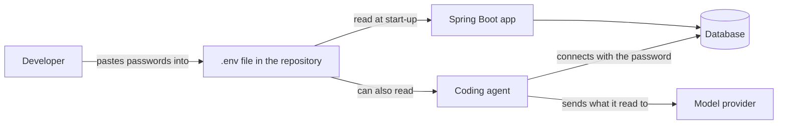
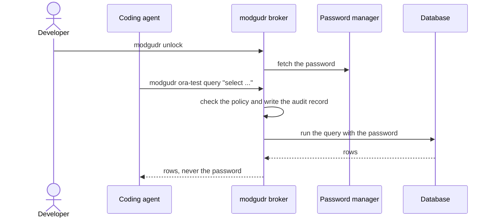
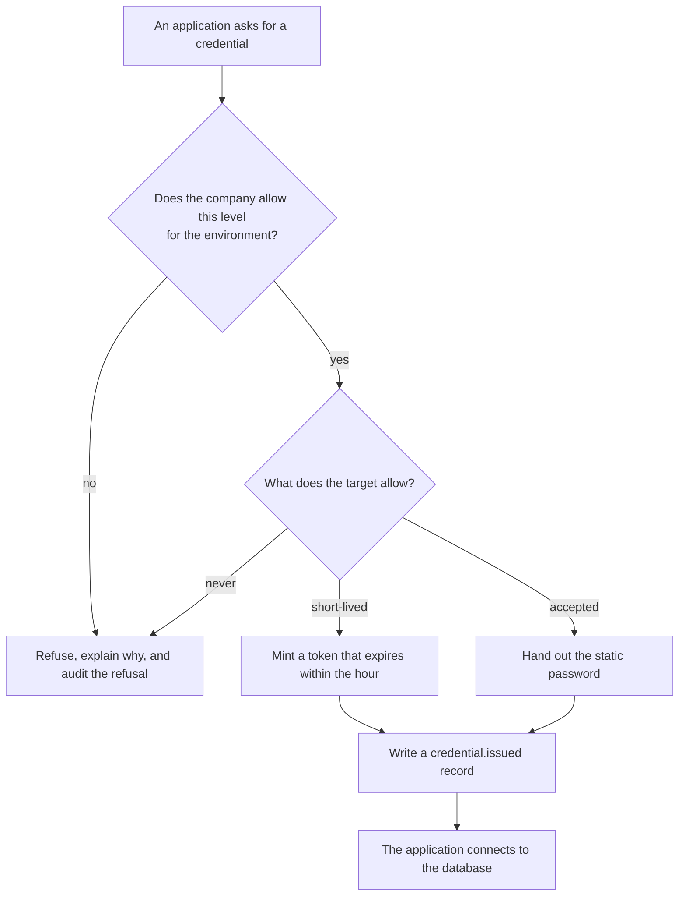
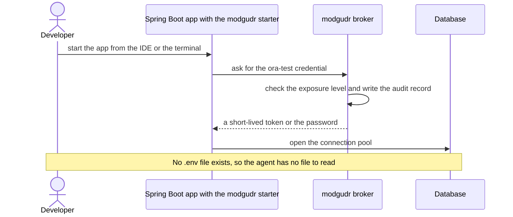
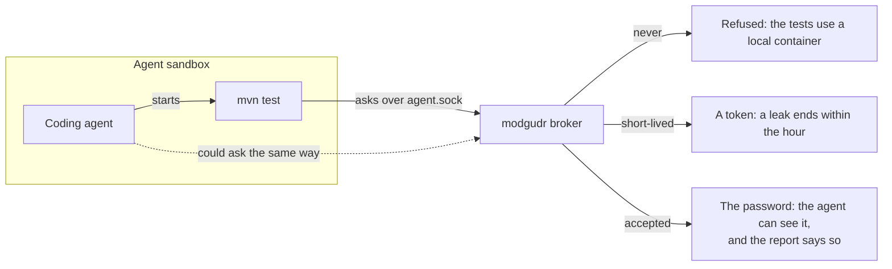
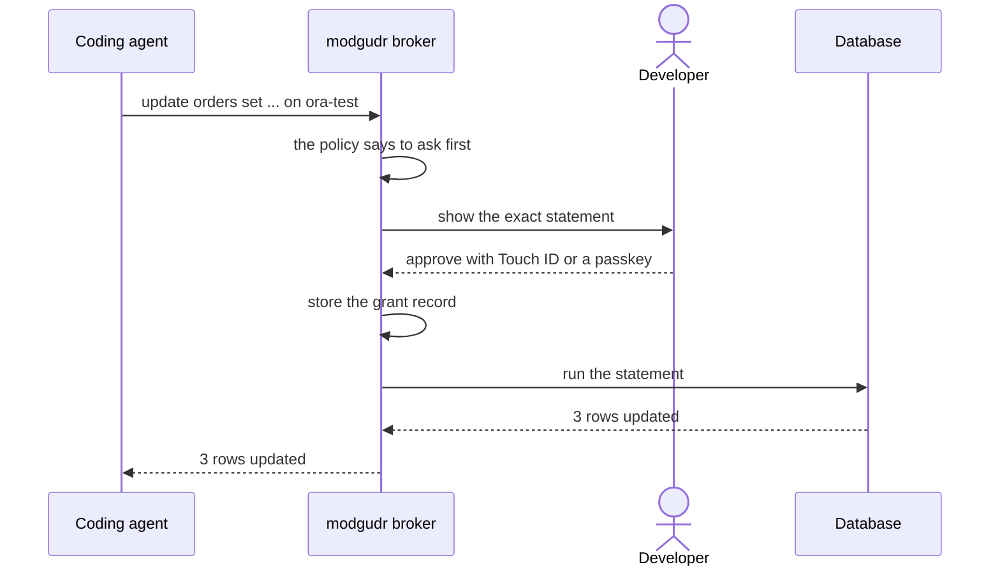
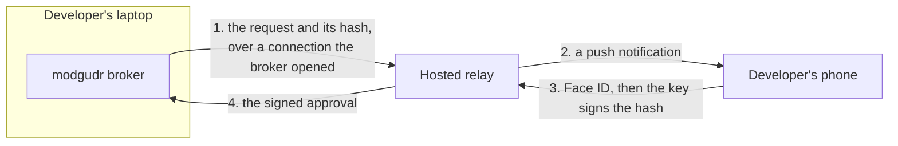
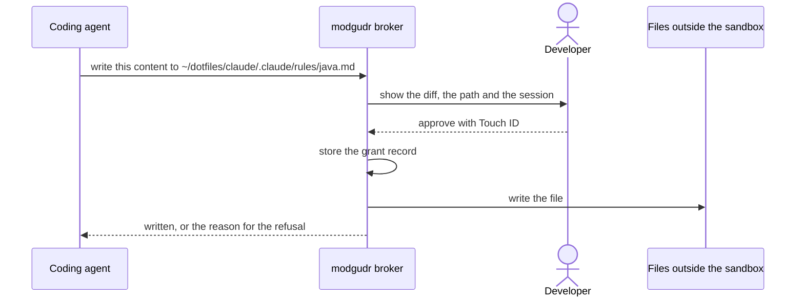
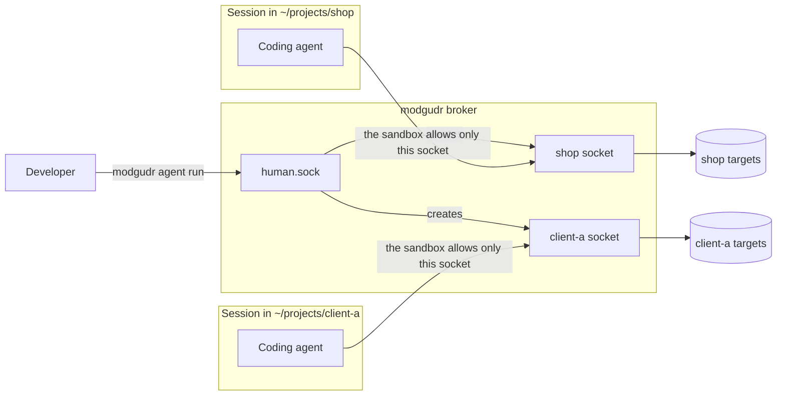
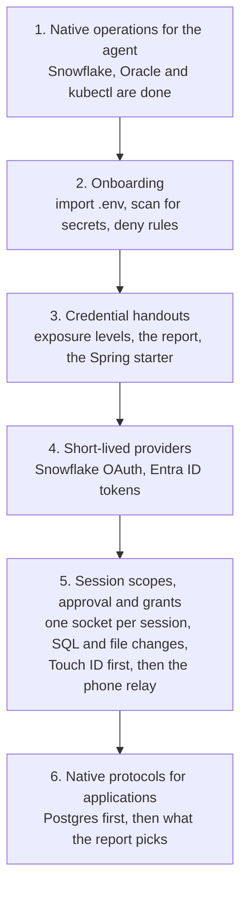

# Future plans

This page describes where modgudr goes after the MVP. It records the decisions from a design
discussion in October 2026, and it explains why each decision makes sense. None of this is built
yet. Each section says what we plan, and the last sections give the order of the work and the
questions that remain open.

## The problem modgudr solves

Developers already hold database passwords. To work with a coding agent, they often paste those
passwords into a `.env` file in the repository. The agent can read that file, so the passwords end
up in its context and its transcripts, and they reach the model provider.



modgudr replaces that file. The broker holds the passwords, and the agent gets results instead of
credentials. We want to build modgudr as a product for every developer who works this way, not as a
tool for one team. `why-developer-centric.md` explains why the product starts on the developer's
laptop and how often developers hold secrets today.

## What a local install promises

A developer installs modgudr on their own laptop, without a central service. That makes the product
easy to adopt, because nobody has to open a ticket with a platform team. It also limits what the
product can promise, and we pitch it for exactly what it delivers.

| A local install delivers | A local install cannot deliver |
| --- | --- |
| The password never enters the agent, its transcripts or its scripts | Passwords kept away from the developer, who still supplies them |
| The agent reads by default and cannot write without approval | Narrower database grants for the developer |
| The developer approves the agent's elevated access | Approval by a second person that the developer cannot bypass |
| An audit trail that catches accidents | An audit trail that an admin on the laptop cannot change |

So the local product protects developers from their own agents. A company that wants to take
passwords away from its developers needs a broker that runs centrally. That becomes the enterprise
tier described below.

## Why a `.env` file holds a secret

A `.env` file costs a developer nothing, so modgudr has to be at least as easy for the common cases.
Each line in the file exists for one of three reasons, and modgudr handles each reason differently.

1. **The agent queries a database.** modgudr handles this today for Snowflake, Oracle and kubectl.
   The agent calls an operation such as `query`, and the broker returns rows.
2. **An application connects at start-up.** A Spring Boot app or a test suite opens a connection
   pool. modgudr implements no wire protocol for applications, so it cannot help yet. This is the
   most common reason a `.env` file exists.
3. **An application calls an API.** The file holds keys for a storage account, a message bus or a
   SaaS service. The planned `http` connector covers the agent's side of this case.

The first case already works, and the diagram below shows it.



The second and third cases need a way to give an application its credential. The next section
describes that.

## Credential handouts

An application that modgudr has no native protocol for still needs its credential. modgudr will hand
the credential to the application when the target's policy allows it. We call this a credential
handout.

A handout is never a fallback. The broker never decides on its own to hand out a secret because a
native operation is missing. A target allows handouts only when its policy says so, and only up to
the level that the company allows.

### Exposure levels

Every target declares how far its credential may travel. The setting belongs in the `credential`
block, next to the existing `tier`:

```yaml
ora-test:
  type: sql
  env: test
  credential: { tier: dedicated, exposure: accepted }
  secret: bws:4f1c…
```

There are three levels:

- **`never`** is the default. The broker uses the credential itself and returns only results. Every
  handout request is refused.
- **`short-lived`** hands out a token that expires within an hour and can only do what its role
  allows. If the token leaks, the leak ends on its own.
- **`accepted`** hands out the static password. The developer chose this level on purpose, the audit
  records every handout, and the exposure report lists the target.

The company file caps the level for each environment, in the same way that `ceiling` caps risk
today. A company can set `exposure: never` for `prod`, and no developer file can raise it.

The policy lint ties each level to a kind of credential. A target with a static `secret:` may use
`never` or `accepted`. Only a target whose `provider` mints expiring tokens may use `short-lived`.



### When the developer starts the application

A small Spring Boot starter asks the broker for the credential while the application starts. The
developer adds one dependency and deletes the `.env` file. When the target says `never`, the starter
stops the application and explains why. That way the developer learns about the exposure levels at
the moment they matter.



### When the agent starts the application

The agent often runs the tests or starts the application itself. That process runs inside the
agent's sandbox, where it can reach `agent.sock` and nothing else. If such a process can fetch a
credential, the agent can fetch the same credential with one command. No design can prevent that,
so modgudr says it openly.



The pilot design promised that the broker "has no operation that returns a secret". Handouts change
that promise. From now on, the broker returns a secret only when the target's exposure level allows
it and the company cap permits that level.

### The audit record and the exposure report

Every handout writes a new lifecycle record, `credential.issued`. The record names the target, the
environment, the exposure level, the channel and the client, such as the Spring starter and its
version. It also says when the credential expires. It never contains the value, which matches what
the audit writer already promises.

A new command, `modgudr exposure`, builds a report from the policy and these records. The report
lists the credentials that the agent can see, the ones that never expire, and when the broker last
handed out each one. It then says how to reduce each exposure.

The report also guards the product against a slow drift. If most targets end up as `accepted`,
modgudr turns into a weaker secrets injector with an audit log. The report makes that drift visible,
and it tells us what to build next to reverse it.

### Short-lived credentials

Applications will depend on handouts for a long time. The level of those handouts therefore decides
how much the product protects. Each provider that mints expiring tokens moves a group of targets
from `accepted` to `short-lived`, without any wire protocol.

- Snowflake accepts OAuth tokens.
- Azure databases accept Entra ID tokens. The existing `azure-cli` provider can already fetch one.
- Recent Oracle releases accept Entra ID tokens when someone configures each database for it.

## Native protocols for applications

A native protocol lets an application connect without holding the password at all. That is the only
way to move an application's target to `never`. It is also the most expensive work on this page.

Postgres is the cheapest place to start, because its wire protocol is simple and well documented.
Oracle's protocol is the hardest, and the pilot already rejected a proxy for it. A JDBC front end
through Apache Calcite Avatica stays parked. One reason is that the Avatica driver reports its
product name as "Avatica", so Hibernate cannot detect the database dialect on its own.

The exposure report picks the order. The targets that most often depend on `accepted` handouts are
the ones where a native protocol pays off first.

## Onboarding from a `.env` file

A developer meets modgudr when they decide what to do with their `.env` file. Three small features
make that moment easy:

- **`modgudr import .env`** reads the file and moves each database credential into the store. It
  writes a target for each one, and it lists the lines it could not handle.
- **`modgudr doctor`** finds `.env` files in the working tree and reports which secrets the agent can
  read. Developers get value from this before they move a single password.
- **`modgudr agent-setup`** blocks `.env` files for both the agent's Read tool and its sandboxed
  Bash tool. This protects developers on the first day.

The deny rules expose a tension at once. When the agent cannot read the file, it cannot start the
application either. The developer then has to choose an exposure level, and the import command
should ask that question directly.

## Approval and elevated access

The agent reads by default. When it needs more, it asks, and the developer approves. Every approval
creates a grant, and modgudr stores each grant as a record. The record says who asked, what the grant
covers, how long it lasts, why it exists, who approved it, and the signature.



A few rules keep approval meaningful:

- The developer approves a scope, not a mood. A grant names one session, one target, one
  environment, an action class, a row limit and a duration. For writes on prod, the developer
  approves each statement with the SQL in front of them.
- A request that gets no answer is refused. The broker also limits how often the agent may ask, so
  the agent cannot wear the developer down.
- A plain "Approve?" push button is not enough. Attackers already use repeated push prompts to wear
  people down. The approval must sign the exact request.

### Approval on the laptop first, then on the phone

The developer usually sits at the laptop while the agent works, so Touch ID covers most requests. A
phone matters when the agent runs for a long time while the developer is away.

#### The signature carries the security, not the channel

The channel that delivers a request to the phone does not need to be trusted. What matters is the
answer. The phone signs the exact request with a key that never leaves its secure hardware, and the
broker checks the signature against a key that the developer enrolled earlier.

The broker builds a request that names the session, the scope, the target, the action, the
statement and the duration. It hashes the request together with a random value and an expiry time,
and that hash becomes the challenge the phone signs. The broker accepts an approval only when four
things hold:

- The signature verifies against the enrolled key.
- The hash matches the pending request.
- The approval has not expired.
- Nobody has used the approval before.

Enrolment happens on `human.sock` with Touch ID. Otherwise the agent could enrol a phone of its own.

#### How the answer gets back to the laptop

The laptop sits behind NAT, so the phone cannot reach it. The broker therefore keeps an outgoing
connection open to a relay, and the answer comes back through that connection. Nothing ever
connects in to the laptop. The relay only carries messages. It never sees a credential or a row of
data, and it cannot approve anything.



#### Three ways to approve, from cheapest to best

**1. Touch ID and Apple Watch on the Mac.** This needs no infrastructure. A Secure Enclave key can
demand Touch ID or a nearby Apple Watch for every signature, so the broker gets a signed grant
record without any server. It covers the developer at the desk and nearby, and it belongs in the
free tier. Python cannot reach the Secure Enclave, so this needs a small Swift helper. It fits the
user-session helper that the pilot already plans.

**2. A web app on the phone, with Web Push and a passkey.** The developer adds a modgudr page to the
phone's home screen. iOS has supported Web Push for home-screen web apps since iOS 16.4, and Android
supports it in any browser. A passkey on the phone signs the approval. This needs an HTTPS domain
for the page and the relay for the answers, which makes it the first paid feature. It needs no App
Store, and it works on iOS and Android from the first day.

Its weakness is that we serve the page's code. A compromised relay could show `select` on the
screen while the challenge hashes `drop`. We state that limit openly.

**3. A native app.** It gives the best experience and the strongest integrity. Its code arrives
signed through the App Store, so the relay cannot change what the phone shows. The request is
encrypted end to end with a key exchanged at pairing. The relay then sees only ciphertext and never
reads the SQL text, which may itself contain data. A notification can carry an approve button
behind Face ID.

#### Why the native app costs the most

Money is not the main cost. Apple charges $99 a year for a developer account, and Google charges $25
once. The cost is the work that never stops after the first release:

- **Two platforms instead of one.** The web app is one codebase for iOS and Android. A native app
  needs Swift and Kotlin, or a cross-platform framework that adds a layer between the app and the
  secure hardware and push features we depend on.
- **Every release goes through review.** A security fix for the web app ships in minutes. A fix for
  a native app can take days, and Apple can reject an update.
- **The app must follow the operating systems.** iOS and Android change every year, and each change
  can break notifications, background behaviour or key storage.
- **Open-source users cannot easily build it.** A user cannot sign their own iPhone app, so they
  must trust our App Store build anyway.
- **A lost phone means more work.** Keys in a native app live on one device, so we need flows for a
  new phone, a lost phone and a second phone. Passkeys sync through iCloud Keychain or Google
  Password Manager, so the operating system handles most of this for the web app.

The relay costs the same for both, so it makes no difference. A minimal native app is small: one
screen with the request and a Face ID button. Its first version costs little. Keeping two of them
alive for years is the expense.

#### Channels that may notify but never approve

Telegram, Slack, Teams, SMS and ntfy prove that someone controls a chat account, a phone number or
a topic name. They do not prove that the developer approved this exact statement. They may say "a
request is waiting" and link to the signed approval, and nothing more. Teams will ask for Slack
approval when a second person must approve. The answer stays the same: Slack carries the link, and
the passkey signs.

A plain "Approve?" button also invites push fatigue. The phone must show the statement, the target
and the duration, and the broker limits how often the agent may ask. A request that times out stays
refused.

#### The order

1. **Now:** Touch ID and Apple Watch through a Secure Enclave key, so every approval is signed from
   the start.
2. **The first paid feature:** the web app with Web Push, a passkey and a relay that only carries
   messages.
3. **When customers ask for it:** a thin native shell around the same page. It adds signed code and
   better notifications, and it keeps the page and the relay unchanged. End-to-end encryption comes
   with it.

The grant record and the signature format stay the same through all three steps. The broker only
gains approvers, and nothing gets rebuilt.

### Approving file changes and commands

The same approval works for more than SQL. The sandbox keeps the agent inside the project
directory, and Claude Code also keeps the agent away from its own instructions and settings:
`CLAUDE.md`, `settings.json`, hooks, skills and rules. Both protections are right, but they turn the
developer into the agent's hands. The agent writes a script, and the developer copies it into a
terminal and runs it. That habit teaches developers to run whatever the agent hands them, which is
weaker than an approval that shows the exact change.

So the agent asks the broker instead. It sends the change over `agent.sock`, either as the new
content of each file or as a script with its full text. The broker shows the developer exactly that,
the developer approves with Touch ID, and the broker applies the change as the developer, outside
the sandbox. The broker stores a grant record, as it does for SQL.



The rules for SQL carry over, and a few are specific to files:

- **The approval covers the exact change.** The signed hash covers each path with its old and new
  content, or the full text of a script. The broker checks the old content right before it writes,
  so a file that changed after the approval makes the request fail.
- **One request, one change, no time window.** The broker never grants "write access to a directory
  for 30 minutes". During such a window the agent could rewrite hooks or instructions that every
  later session follows, and nobody would see it happen.
- **File content beats a script.** The broker writes file content itself and knows exactly what it
  touched. A script can do anything, so the broker shows all of it, runs it with a clean
  environment, and the approval says that it runs as the developer.
- **Instructions and settings get the plainest warning.** A change to `CLAUDE.md`, `settings.json`,
  hooks, skills or rules outlives the session and shapes every later one. The approval says so, and
  the broker never bundles such a change with others.
- **A refusal carries its reason**, so the agent explains it to the developer instead of looking
  for another way through.

Until the broker does this, a small runner outside the repository fills the gap. The agent writes
each script to a queue, and the developer runs one command that shows the script with its hash and
runs it only when given that hash. It removes the copying but keeps the developer as the approver,
without a signature or a grant record.

## Session scopes

Today every agent session can use every target. All sessions share one `agent.sock`, and the broker
checks only the peer's uid, which is the same for every session. `modgudr agent run` sets
`MODGUDR_SESSION`, but the agent can change that variable, so it serves the audit and
`sessions kill` and cannot enforce anything.

### Why sessions need their own scope

**Elevated grants require it.** Say the developer approves write access on `ora-test` for 30
minutes. Without session scopes, every agent on the laptop gets that access, including one the
developer forgot in another terminal. The approval has to name the session it applies to, or it
means nothing. So session scopes must exist before grants ship.

**Developers run several agents at once.** Worktrees and parallel Claude sessions are normal now.
Consultants work for several clients on one laptop, and an agent working for client A must never
query client B's database. A client contract may even require that separation.

**Scopes limit the damage from prompt injection.** An agent that fixes CSS might read a poisoned
issue. If its session reaches only the frontend's targets, the injection cannot touch prod data.

Scopes stay optional. A developer who works on one product and defines no scope notices nothing.

### How Bitwarden Secrets Manager does it

Bitwarden puts each secret in a project. A machine account gets read access, or read and write
access, to some projects, and a process proves its identity with the machine account's access token.

That model works between machines, because each machine holds a different token. It barely works
between sessions on one machine. The tokens for two scopes sit with the same user, and an agent
that finds the second token can use it. `bws run` also hands the secret values to the process, so
the agent sees them. Access is standing, with no elevation and no approval.

| | Bitwarden Secrets Manager | modgudr with scopes |
| --- | --- | --- |
| Unit of scope | Project | Scope in the targets file |
| Identity | A machine account's access token | The session's own socket, enforced by the sandbox |
| Can another session on the laptop steal it? | Yes, the token is a file or a variable | No, while the sandbox holds |
| Does the agent see the secrets? | Yes | No |
| Time-limited elevation | No | A grant for one session, approved by the developer |

In short, Bitwarden decides which secrets a machine may read, and modgudr decides what each agent
session may do.

### Defining scopes

A scope lives in the developer's targets file, outside every repository:

```yaml
scopes:
  client-a:
    paths: [~/projects/client-a]
    targets: [a-ora-test, a-snowflake-dev]
  shop:
    paths: [~/projects/shop]
    targets: [shop-pg-test, shop-pg-prod]
```

`modgudr agent run` picks the scope once, from the directory it starts in. It never reads a scope
from a file in the repository, because the agent can edit the repository and widen its own scope.
A `cd` later in the session changes nothing.

### Binding a session to its scope

Four mechanisms can tie a call to a session. They range from weak to strong:

1. **A session id in an environment variable.** This is what exists today. The agent can change it,
   so it only labels the audit.
2. **The process tree.** The broker reads the peer's process id from the socket (`LOCAL_PEERPID` on
   macOS, `SO_PEERCRED` on Linux). It walks up the parents until it finds a session root that
   `agent run` registered. A process that escaped its parent has no root, and the broker refuses
   it. Process ids get reused, so the broker also compares start times.
3. **One socket per session.** `agent run` creates `run/sessions/<id>.sock` and starts the agent
   with sandbox settings that allow only that socket. The sandbox enforces the scope, and the
   broker only maps the socket to its scope.
4. **A separate OS user or container per session.** These are levels L1 and L2, and they give each
   session its own socket naturally.

We build the third mechanism, check the second as a backup, and keep the first for the audit.



### Rules that keep a scope closed

- **Only a human starts a session.** If the agent could run `modgudr agent run` for another scope,
  scopes would mean nothing. Creating a session therefore goes through `human.sock`, which the
  agent cannot reach.
- **A grant belongs to one session.** The approval shows the session, for example "shop, worktree
  fix-login, write on shop-pg-test, 30 minutes". The grant ends when the session ends.
- **Elevation never crosses scopes.** A grant can raise the access level inside the session's scope.
  It cannot add a target from another scope, which needs a new session.
- **The shared socket goes away.** The managed settings allow `agent.sock` today. As long as they
  do, every session can reach every target through it.

At L0, the developer's own terminal has no scope and reaches everything through `human.sock`. That
is intended. Scopes protect against the agent, not against a compromised user account.

## Product tiers

Individual developers rarely pay for safety tools. Companies pay for control, which needs something
central. So the product is free on the laptop, and a company pays for what works across a team.

We will not sell features that run only on the laptop. The code is Python under Apache-2.0, so
anyone can delete a licence check. A licence check would also break the fail-closed design, because
a failed check would lock developers out of their databases. We sell a hosted service instead, and
the trust stays on the developers' laptops.

| Tier | What it adds | What the customer runs |
| --- | --- | --- |
| Free | The broker, the policy, agent isolation, reads by default, approval with Touch ID | Nothing beyond the laptop |
| Team | A signed company policy pulled from a git repository, and audit export to the company's SIEM | A git repository |
| Paid | Phone approval, approval by a second person, notifications, the team's exposure report and grant history | Nothing, because we host it |
| Enterprise | A centrally run broker that takes passwords away from developers | Their own broker service |

The phone relay is the first feature worth paying for. Nobody can patch it out, because without the
relay there is no phone approval.

The tiers follow the order in which an organisation takes over a tool that its developers adopted.
`why-developer-centric.md` describes that handover in five stages:

| Stage | Tier |
| --- | --- |
| 1. One developer | Free |
| 2. A team | Team |
| 3. The organisation watches | Paid |
| 4. The organisation sets limits | Paid, with policy and managed settings shipped through device management |
| 5. The organisation removes access | Enterprise |

Each tier adds a layer on top of the one before. Nothing a developer configured stops working when
the organisation arrives.

## What the code needs now

We build the local product so that the enterprise tier becomes another way to deploy the same
broker. That avoids a rewrite later, and it takes four changes:

- **Treat the caller's identity as an abstraction.** Today the broker identifies a caller by the
  peer uid. Next it will identify the session by its socket, and later by an OIDC subject. The
  policy and the audit format must not depend on `uid`.
- **Store every grant as a record**, even when the developer approves with Touch ID.
- **Load the company policy from a signed source.** When the broker can check which repository a
  file came from and which key signed it, the team tier costs little to build.
- **Let approvers plug in.** Touch ID comes first, and the relay comes later.

The backlog changes too. Approval and grants move forward, and we design them around grant records
and pluggable approvers. Running the broker as a separate OS user moves back. The local product
promises protection against accidents plus approval from outside the agent's reach, so that extra
hardening matters less than it did.

## Windows

Many Java developers work on Windows, so a product for them must support it. Supporting Windows is a
project, not a port, because the design relies on three things that Windows lacks:

- **The agent sandbox.** Claude Code's sandbox runs on macOS, Linux and WSL2, but not on native
  Windows. Without it, the agent can read every file the user can read and reach every socket.
- **Unix sockets in asyncio.** Python's asyncio cannot serve Unix sockets on Windows. The broker
  would need named pipes or loopback TCP with a token, and Windows has no peer uid either.
- **The start-up hardening.** The broker blocks debuggers on macOS and Linux. Windows needs other
  system calls for the same effect.

We support Windows through WSL2 first. Claude Code already sends Windows users to WSL2 for
sandboxing, so the agent keeps its full protection there. Native Windows follows later, for the
human side and the Spring starter.

One case needs an early test. When IntelliJ starts the application on native Windows while the
broker runs inside WSL2, the application has to cross into WSL2 to reach the broker. That test
decides whether the WSL2 route feels natural to a Windows developer.

## Order of the work



Steps 3 and 5 can run in parallel, because handouts and approvals share only the grant record. The
exposure report from step 3 decides the order inside step 6.

## Open questions

1. Who runs the hosted relay, and where does it run?
2. How soon do we need native Windows, beyond WSL2?
3. Should the Spring starter come first, or a generic way to start any application with its
   credentials?
4. Should an `accepted` handout need a confirmation on `human.sock` the first time a target uses it?
5. Can `modgudr agent run` give each session its own sandbox settings that the agent cannot write?
   And do `allowUnixSockets` entries from those settings merge with the managed settings, or
   replace them? A socket per session depends on both answers.
6. Should a directory that no scope covers get no targets, or a default scope? No targets is fail
   closed, but it adds friction on the first day.
7. Does iOS deliver Web Push to a home-screen web app reliably enough for approvals? Users report
   delays and dropped notifications, so we measure it before the web app becomes the paid feature.
8. Should the broker write the agent's own instructions and settings at all, with the plainest
   warning, or refuse those paths and leave them to the developer's editor?
