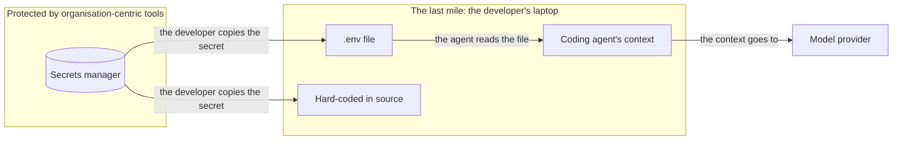
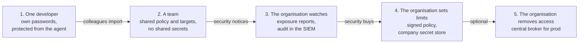

# Why developer-centric secret management

This page explains why modgudr starts on the developer's laptop instead of in a central service. It
also lists what the organisation-centric approach does better, because a security buyer will raise
every one of those points. `future-plans.md` describes how the product grows from here.

## How often developers hold secrets

No survey counts directly how many developers hold production database passwords. Several studies
measure close neighbours of that question, and they all point the same way.

- **Bitwarden asked 600 developers in the US and the UK in late 2023.** 65% said they hard-code
  secrets in source code, and 55% said they keep secrets in clear text. 60% said they manage 100 or
  more secrets.
- **Sauce Labs asked 500 developers.** 70% said they had used a coworker's credentials to get around
  access restrictions, and 41% said they do it regularly.
- **Red Gate surveyed database professionals in 2024.** 43% said they test against full-size
  production backups. 35% said they have no approach for protecting the sensitive data in them. So
  developers often see production data even when they do not hold the production password.
- **GitGuardian counted 23.8 million secrets leaked on public GitHub in 2024.** That is 25% more
  than the year before. 70% of the secrets leaked in 2022 still worked.
- **Verizon's 2025 breach report found stolen credentials at the start of 22% of breaches.** No
  other way in was more common.
- **Knostic found that Claude Code loads `.env` files on its own**, without asking. The secrets in
  those files therefore reach the agent's memory.

All of these are vendor surveys or vendor research, and most of them rely on what developers say
about themselves. The picture is still consistent. Most developers keep secrets in places that are
not safe, and coding agents have made those places easier to read.

## The strongest argument

GitGuardian also looked at 2,584 repositories whose teams use a secrets manager. Those repositories
leaked secrets at a rate of 5.1%, which is higher than the 4.6% average across GitHub. The usual
cause was a developer who pulled a secret out of the manager and hard-coded it somewhere else.

That number sums up the argument. Organisation-centric tools protect the vault. A secret leaks after
it leaves the vault: on the developer's laptop, in a `.env` file or in an agent's context. No
central vault reaches that last step, and modgudr is built for exactly that place.

modgudr replaces the copy step. The secret stays in the broker, and the agent gets results instead.

## Where the developer-centric approach wins

**It protects the place where secrets leak.** Central tools such as Vault, Key Vault and CyberArk
control how a company stores and hands out secrets. They stop caring once a developer copies a
secret into a file. modgudr starts at that point.

**It works with the credentials developers already have.** Developers hold passwords today, and
they will keep holding them for years. A tool that works only after a company has redesigned its
access model cannot help anyone in the meantime.

**Developers can adopt it without asking anyone.** Nobody has to open a ticket with the DBAs or wait
for a platform team. A developer installs the tool and becomes safer the same afternoon.

**The agent problem is personal.** The agent acts on behalf of one developer, inside that
developer's session. Central tools do not know that the agent exists. The developer is the right
person to decide what their agent may do and to approve its requests.

**It fits consultants and contractors.** People who work for several clients hold passwords for
systems at each of them. No single client's central tool covers all of those systems, but a tool on
the consultant's laptop does.

**It creates no central target.** A central broker that holds every database password is the most
valuable thing an attacker could compromise. When it goes down, every developer stops working at
once. A local broker does not fail that way.

## Where the organisation-centric approach wins

**Only a central tool removes standing access.** A local tool cannot take a password away from the
person who supplied it. If the problem is that developers hold too many rights, a local tool does
not solve it.

**A local tool can make standing access feel acceptable.** This is the risk we take most seriously.
Once a developer's prod password sits safely inside modgudr, nobody feels pressure to ask the DBAs
for a read-only account. The tool could end up preserving the over-privilege it was meant to reduce.

**Offboarding needs a central view.** When a developer leaves, the company has to know which
credentials they held, so that it can rotate them. A local tool knows that only if its audit
records reach somewhere central.

**Compliance needs an audit trail that the developer cannot edit.** On a laptop where the developer
is an admin, the developer can change the local audit file.

**The security team holds the budget.** Developers adopt tools, but the security team usually pays
for them.

## Not a choice, but an order

The two approaches do not compete. Developer-centric is better at the last mile, where secrets
actually leak. Organisation-centric is better at taking access away, which is what security teams
eventually pay for. A product can do both, one after the other.

Many tools have taken this path. Developers set up Tailscale on their own, and IT later bought the
business plan with single sign-on and access rules. 1Password and Bitwarden lead from personal plans
into business plans. Snyk called itself "developer-first security" and sold to security teams once
developers had adopted the free scanner. GitGuardian is free for individual developers and sells to
the security team.

So we position modgudr this way: **organisation-centric tools protect the vault, and modgudr
protects the last mile.** Developers adopt it on their own, and the organisation then takes over.

## From one developer to the organisation

The handover happens in five stages. Each stage adds a layer on top of the one before, so nobody has
to reinstall anything.

1. **One developer** installs modgudr with their own passwords. It protects them from their agent.
2. **A team** shares a policy repository and a list of targets, without any secrets, and colleagues
   import them. Each developer still holds their own credentials. This is how the tool spreads.
3. **The organisation watches.** The security team sees the team's exposure reports and receives
   the audit records in its SIEM. This is where the security team becomes the buyer.
4. **The organisation sets limits.** It ships signed company policy and the managed settings
   through device management. Its own secret store replaces the personal vaults, and short-lived
   credentials replace static ones.
5. **The organisation removes access.** A central broker takes over prod, and the developers'
   personal prod passwords are revoked. Some organisations never reach this stage, and that is fine.

### The rule for every stage

Nothing a developer configured may stop working when the organisation arrives. If a handover breaks
the setup that developers already use, they fight the organisation, and the organisation drops the
tool.

The current design already follows this rule in three places:

- The policy has two layers. Root owns the company file, and the developer owns the targets file.
  The company layer only adds limits, such as risk ceilings and exposure caps.
- The managed settings are a drop-in file, so an organisation can ship them through device
  management.
- Secret stores are plugins, so an organisation's vault can replace a personal vault without
  changing any target.

### Where the handover can go wrong

**The security team may see the tool as shadow IT.** Snyk and GitGuardian started by only scanning,
which a security team accepts easily. modgudr holds production passwords, so the bar is much higher.
Open source helps, but we also need signed releases and a published threat model long before the
first organisation arrives.

**The organisation may replace the tool instead of buying it.** Many organisations already pay for
CyberArk, Vault or a cloud key store. If modgudr competes with those products, it loses. If it plugs
into them as a store and adds the last mile and the agent, it gets bought.

**A licence change can feel like a betrayal.** In 2021 Docker started charging large companies for
Docker Desktop, and the backlash was loud. We decide now what stays free forever, and we write it
down.

**Nobody may notice the spread.** Tailscale and Slack tell an admin how many people at their domain
already use the product. modgudr needs a similar trigger that developers opt into. One candidate is
a team's first shared policy repository, which makes the adoption visible.

## Least privilege as a selling point

The exposure report also answers the risk of standing access. It can list every target where the
developer holds a write password but the agent only ever reads. A message such as "you hold a write
password, but you have only read for 90 days" gives the developer a reason to ask for a read-only
account. That turns the local tool into pressure toward least privilege, instead of a comfortable
home for over-privilege.

## Sources

- [GitGuardian: The State of Secrets Sprawl 2025](https://blog.gitguardian.com/the-state-of-secrets-sprawl-2025/)
- [Help Net Security: Report on the State of Secrets Sprawl 2025](https://www.helpnetsecurity.com/2025/03/19/report-the-state-of-secrets-sprawl-2025/)
- [CPO Magazine: 70% of leaked secrets remain active for two years](https://www.cpomagazine.com/press-releases/gitguardian-report-70-of-leaked-secrets-remain-active-for-two-years-urging-immediate-remediation/)
- [Bitwarden: Developer secrets and the future of passkeys](https://bitwarden.com/es-la/resources/security-survey-developer-secrets-and-the-future-of-passkeys)
- [Bitwarden: The Survey Room](https://bitwarden.com/resources/the-survey-room/)
- [Business Wire: Sauce Labs developer survey](https://www.businesswire.com/news/home/20230822026925/en)
- [Red Gate: State of the Database Landscape 2024, security and testing](https://www.red-gate.com/solutions/state-of-database-landscape/2024/security-and-testing/)
- [Verizon: Credential stuffing research from the 2025 DBIR](https://www.verizon.com/business/resources/articles/credential-stuffing-attacks-2025-dbir-research/)
- [Infosecurity Magazine: Verizon DBIR reveals a 34% jump in vulnerability exploitation](https://www.infosecurity-magazine.com/news/verizon-dbir-jump-vulnerability/)
- [Knostic: Claude and Cursor `.env` file secret leakage](https://www.knostic.ai/blog/claude-cursor-env-file-secret-leakage)
